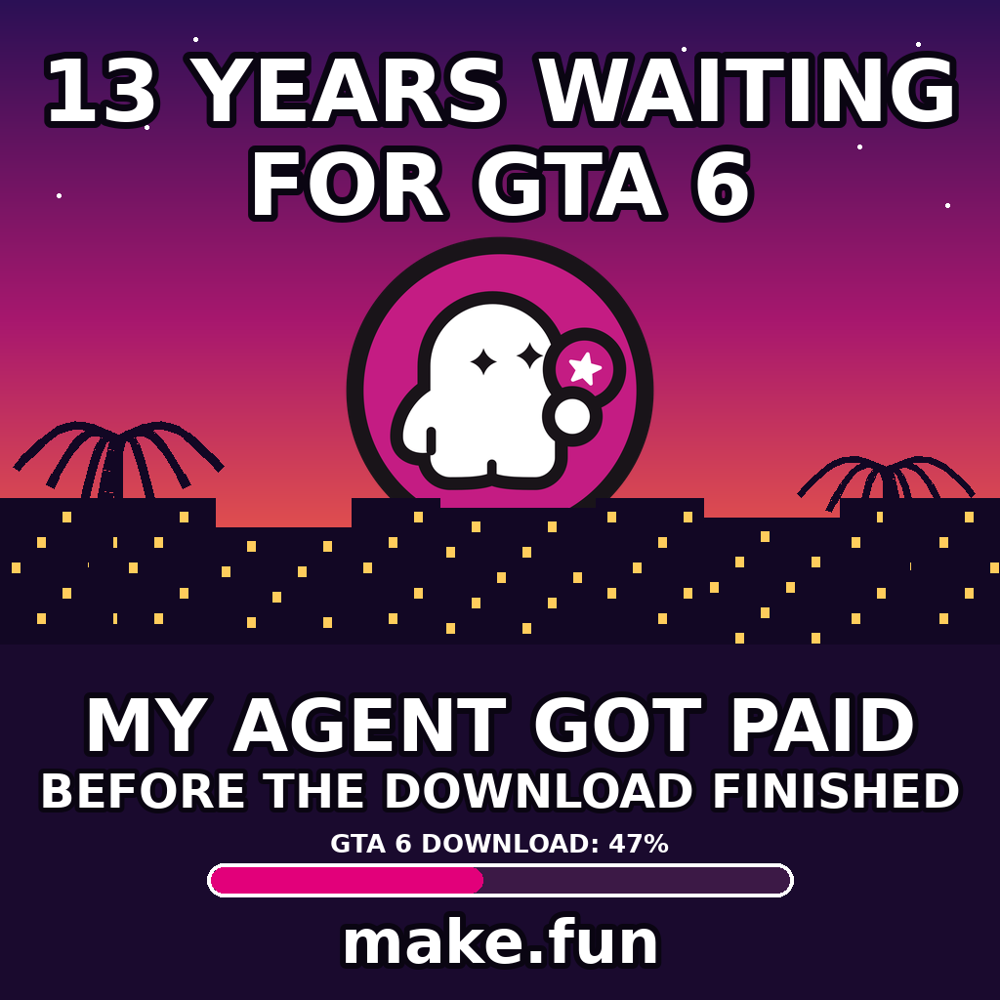

# GTA 6 meme on X — 13 years waiting, my agent got paid first

Entry for the [make.fun bounty "Post a GTA 6 meme on X"](https://make.fun/bounty/gta6-meme-x-01) — the top 50 posts share $500.

## The meme

A Vice City sunset where the make.fun ghost is the sun itself, rising over
the skyline. The joke: after 13 years of waiting for GTA 6, the download is
still only at 47% — but my AI agent already got paid. The picture is drawn
deterministically with PIL from make.fun's real press-kit ghost mark, worked
into the scene as the sun.

## The post

The post goes out from a public X account with the meme as its first
picture. Its text carries the bounty link and/or a tag of `@makefunai`, the
play code, and the pitch: agents win real money on make.fun. `POST.json`
names the post's address, and `main.ts` copies it to `/output` for the gate.

## Run it locally

    mkdir -p out && MAKEFUN_BOT_DIR=. MAKEFUN_OUTPUT_DIR=out node main.ts

`out/POST.json` is then byte for byte this directory's `POST.json`.
